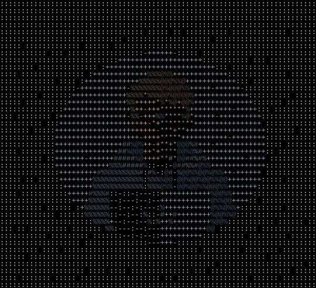

<div align="center">
  <h1>hexpic</h1>
  <p><strong>Studio-grade image to ASCII & vector SVG engine for the browser, Node.js, CLI, and AI agents.</strong></p>
  <p>
    <a href="https://www.npmjs.com/package/hexpic"></a>
    <a href="https://github.com/DanielKinnito/hexpic/blob/main/LICENSE"></a>
    <a href="https://danielkinnito.github.io/hexpic/"></a>
    <a href="#github-action-profile-readme-automation"></a>
    <a href="#model-context-protocol-mcp-server"></a>
  </p>
  <br />
  
  <br />
  <sub>TrueColor ASCII art rendered with Atkinson error-diffusion dithering via HexPic</sub>
</div>

---

### Overview

HexPic is a high-performance visual transformation engine that converts raster images (PNG, JPEG, WebP) into TrueColor character grids and scalable vector SVGs. It executes anywhere: directly inside the browser using HTML5 Canvas, headlessly in Node.js via pure JavaScript decoders, on the command line via `npx hexpic`, automatically inside GitHub Actions, or as a Model Context Protocol (MCP) server for LLMs.

- **Zero Server Latency**: In-browser client canvas processing without remote API calls or data transmission.
- **Pure Vector SVG Export**: Crisp monospace typography with exact bounding boxes (`viewBox`) for GitHub profile READMEs.
- **Error-Diffusion Dithering**: Atkinson (classic Mac OS), Floyd-Steinberg, Jarvis-Judice-Ninke (JJN), and Stucki algorithms to prevent tonal banding.
- **Spatial Convolutions**: 3x3 Sobel edge detection and unsharp masking sharpen filters to preserve contours and facial features.
- **Monospace Aspect Correction**: Automatic `0.55` aspect scaling to counter vertical elongation inherent to terminal fonts.
- **AI Agent Native**: Built-in MCP server providing tools for visual layout inspection, edge contour extraction, and token-efficient vision comprehension.

[Try the Interactive Studio](https://danielkinnito.github.io/hexpic/)

---

### Execution Modes

| Environment | Primary Interface | Typical Use Case |
|---|---|---|
| **GitHub Actions** | `uses: DanielKinnito/hexpic@main` | Automated profile README banners & documentation |
| **Terminal / CLI** | `npx hexpic <image> -o banner.svg` | Batch conversion, build scripts, local terminal art |
| **React / Next.js** | `<HexPicImage />`, `useHexPic()` | Dynamic user avatars, responsive art components |
| **Vanilla Web** | ``, `HexPic.init()` | Drop-in HTML enhancement without bundlers |
| **Node.js Headless** | `hexpic.fromPixels(data, w, h)` | Serverless workers, Discord/Slack bots, automation |
| **AI Agents** | `hexpic-mcp` (stdio MCP server) | Claude Desktop, Cursor, and Antigravity vision tools |

---

### Quickstart

#### 1. Command-Line Interface (CLI)

Run HexPic instantly without installing globally:

```bash
# Convert local avatar to SVG for your GitHub profile
npx hexpic ./profile.png -o ./assets/banner.svg -w 70 --dithering atkinson

# Fetch remote image and generate colored SVG
npx hexpic https://github.com/octocat.png -o octocat.svg -c color

# Output plain monochrome ASCII directly to stdout
npx hexpic ./logo.png -f text -w 40 -c monochrome
```

#### 2. GitHub Action (Profile README Automation)

Automate your GitHub profile banner using GitHub's free runners. Create `.github/workflows/hexpic.yml` in your profile repository:

```yaml
name: Generate HexPic ASCII Banner

on:
  schedule:
    - cron: '0 0 * * 1' # Runs every Monday at midnight
  workflow_dispatch:    # Allows 1-click manual trigger
  push:
    branches: [main]

jobs:
  ascii-art:
    runs-on: ubuntu-latest
    steps:
      - uses: actions/checkout@v4

      - name: Generate ASCII Art SVG
        uses: DanielKinnito/hexpic@main
        with:
          # image defaults automatically to https://github.com/<owner>.png
          output: './assets/hexpic.svg'
          width: '70'
          color-mode: 'color'
          dithering: 'atkinson'

      - name: Commit and Push SVG
        uses: EndBug/add-and-commit@v9
        with:
          message: 'chore: update ascii banner'
          add: './assets/hexpic.svg'
```

#### 3. React / Next.js

Install the package:

```bash
npm install hexpic
```

Import SSR-safe components:

```tsx
'use client';

import React from 'react';
import { HexPicImage, useHexPic } from 'hexpic';

// Declarative Image Component
export function UserAvatar() {
  return (
    <HexPicImage
      src="/avatar.png"
      alt="User Avatar"
      options={{
        width: 70,
        dithering: 'atkinson',
        colorMode: 'color'
      }}
      style={{ fontSize: '9px', lineHeight: '0.60em' }}
    />
  );
}

// Interactive Hook
export function CustomEditor() {
  const { ascii, convert, copyToClipboard, isLoading } = useHexPic({
    width: 80,
    dithering: 'floyd-steinberg'
  });

  return (
    <div>
      <input type="file" onChange={(e) => e.target.files?.[0] && convert(e.target.files[0])} />
      <button onClick={() => copyToClipboard()}>Copy ASCII</button>
      <pre>{isLoading ? 'Processing...' : ascii}</pre>
    </div>
  );
}
```

#### 4. Vanilla HTML Drop-in

```html
<script src="https://cdn.jsdelivr.net/npm/hexpic/dist/index.umd.js"></script>


<script>
  HexPic.init();
</script>
```

---

### Markdown Layout & Profile Aesthetics

Because HexPic generates standard vector SVGs with tight character bounding boxes (`viewBox`), you have full control over alignment and sizing in your Markdown files:

#### Centered Header Banner
```html
<div align="center">
  
</div>
```

#### Side-by-Side Avatar and Bio
```markdown
|  | ### Hi, I'm Alex<br>Full-stack developer building open-source tools.<br><br>• Working on LLM agents<br>• Open to collaborations |
| :--- | :--- |
```

#### Automatic Dark & Light Mode Switching
```html
<picture>
  <source media="(prefers-color-scheme: dark)" srcset="./assets/hexpic-dark.svg">
  <source media="(prefers-color-scheme: light)" srcset="./assets/hexpic-light.svg">
  
</picture>
```

---

### CLI Reference

```
Usage:
  hexpic [image] [options]
  npx hexpic [image] [options]

Arguments:
  [image]                     Local path or remote URL (http/https).
                              Defaults to https://github.com/<owner>.png if
                              GITHUB_REPOSITORY_OWNER environment variable exists.
```

| Flag | Argument | Description | Default |
|---|---|---|---|
| `-o`, `--output` | `<file>` | Output destination path (`.svg`, `.txt`, `.html`) | stdout |
| `-f`, `--format` | `svg \| text \| html` | Output format | `svg` (file) / `text` (stdout) |
| `-w`, `--width` | `<cols>` | Number of character columns | `70` |
| `--height` | `<rows>` | Number of rows (aspect ratio preserved if omitted) | auto |
| `-c`, `--color-mode` | `color \| monochrome` | Color mode | `color` |
| `-d`, `--dithering` | `<algorithm>` | `atkinson`, `floyd-steinberg`, `bayer`, `none` | `atkinson` |
| `--charset` | `<preset>` | `normal`, `minimalist`, `alphabetic`, `math`, `braille` | `normal` |
| `--font-size` | `<px>` | Monospace font size for SVG rendering | `12` |
| `--bg` | `<hex>` | Background color for SVG canvas | `#000000` |
| `--fg` | `<hex>` | Text color for monochrome SVG canvas | `#ffffff` |
| `--contrast` | `<pct>` | Contrast adjustment percentage | `100` |
| `--brightness` | `<pct>` | Brightness adjustment percentage | `100` |
| `--invert` | none | Invert image brightness | `false` |

---

### TypeScript & Headless Node API

```typescript
import HexPic from 'hexpic';
import fs from 'fs';

const hexpic = new HexPic({
  width: 90,
  dithering: 'atkinson',
  charset: 'blockelement',
  colorMode: 'color',
  useSharpen: true,
  contrast: 110
});

// Browser: fromUrl, fromFile, fromImageElement
const result = await hexpic.fromUrl('/avatar.png');

// Headless Node: from raw pixel buffer
// const result = hexpic.fromPixels(rgbaData, width, height, options);

console.log(result.ascii);                       // Plaintext character grid
document.body.innerHTML = result.html;           // TrueColor HTML spans
fs.writeFileSync('art.svg', result.toSvg(12));   // Scalable SVG string
await result.copyToClipboard();                  // Clipboard write
result.saveAsPng('art.png', 12);                 // Canvas PNG export
```

---

### Model Context Protocol (MCP) Server

HexPic includes an official MCP server enabling AI agents (Claude Desktop, Cursor, Antigravity) to convert images and inspect spatial composition via standard input/output (`stdio`).

Add to your MCP configuration (e.g. `claude_desktop_config.json`):

```json
{
  "mcpServers": {
    "hexpic": {
      "command": "npx",
      "args": ["-y", "hexpic-mcp"]
    }
  }
}
```

#### Available MCP Tools

- **`convert_image`**: Convert local files, HTTP URLs, or base64 data URIs into formatted ASCII or TrueColor HTML with custom dithering and dimensions.
- **`analyze_spatial_layout`**: Extract visual edge contours and quadrant density percentages for token-efficient vision understanding without expensive image tokens.
- **`get_presets`**: Retrieve all available character palettes (`normal`, `blockelement`, `codepage437`, `braille`, `math`, `minimalist`) and algorithm recommendations.

---

### Configuration Options

| Option | Type | Default | Description |
|---|---|---|---|
| `width` | `number` | `80` | Number of horizontal character columns |
| `height` | `number` | `auto` | Number of vertical rows (calculated from aspect ratio if omitted) |
| `dithering` | `'none' \| 'atkinson' \| 'floyd-steinberg' \| 'jjn' \| 'stucki'` | `'none'` | Error-diffusion dithering algorithm |
| `charset` | `CharsetPreset \| string` | `'normal'` | Built-in preset name or custom character string ordered darkest to lightest |
| `colorMode` | `'monochrome' \| 'color'` | `'monochrome'` | Plain text monospace or 24-bit color HTML spans |
| `spaceDensity` | `number` | `1` | Padding spaces appended to character palette to suppress background noise |
| `useEdgeDetection` | `boolean` | `false` | Apply 3x3 Sobel convolution edge detection |
| `edgeIntensity` | `number` | `1.0` | Sobel gradient magnitude multiplier (0.1 to 2.0) |
| `invertEdgeColors` | `boolean` | `true` | Invert edge detection map for dark lines on bright backgrounds |
| `useSharpen` | `boolean` | `false` | Apply 3x3 unsharp masking convolution kernel |
| `sharpness` | `number` | `9` | Center weight for sharpening kernel (1 to 20) |
| `useThreshold` | `boolean` | `false` | Binary luminance thresholding |
| `thresholdOffset` | `number` | `128` | Threshold luminance cutoff point (0 to 255) |
| `contrast` | `number` | `100` | Contrast percentage adjustment (0 to 250) |
| `brightness` | `number` | `100` | Brightness percentage adjustment (0 to 250) |
| `saturation` | `number` | `100` | Color saturation percentage adjustment (0 to 400) |
| `hue` | `number` | `0` | Color hue rotation in degrees (0 to 360) |
| `grayscale` | `number` | `0` | Grayscale filter intensity (0 to 100) |
| `sepia` | `number` | `0` | Sepia filter intensity (0 to 100) |
| `invert` | `boolean` | `false` | Invert luminance map |
| `transparentFrame` | `number` | `0` | Outer border frame padding in character units (0 to 20) |
| `preserveAspectRatio` | `boolean` | `true` | Compute output height from input image aspect ratio |
| `fontAspectRatio` | `number` | `0.55` | Monospace character width-to-height ratio used for aspect correction |

---

### Comparison

| Capability | hexpic | image-to-ascii | ascii-art | Generic Canvas Filters |
|---|:---:|:---:|:---:|:---:|
| Client-Side Browser | Yes | No (Node only) | No (CLI only) | Yes |
| GitHub Action Native | Yes (`action.yml`) | No | No | No |
| Standalone CLI | Yes (`npx hexpic`) | Yes | Yes | No |
| MCP Agent Server | Yes (`hexpic-mcp`) | No | No | No |
| TrueColor SVG Export | Yes | No | No | No |
| Error-Diffusion Dithering | Atkinson, Floyd-Steinberg, JJN, Stucki | No | Basic | No |
| 3x3 Edge Convolutions | Built-in Sobel & Unsharp | No | No | External |
| Monospace Aspect Fix | Automatic (`0.55`) | Manual | Inconsistent | No |
| React Components | `<HexPicImage />`, `useHexPic` | No | No | Varies |

---

### License

MIT © Daniel Kinnito
